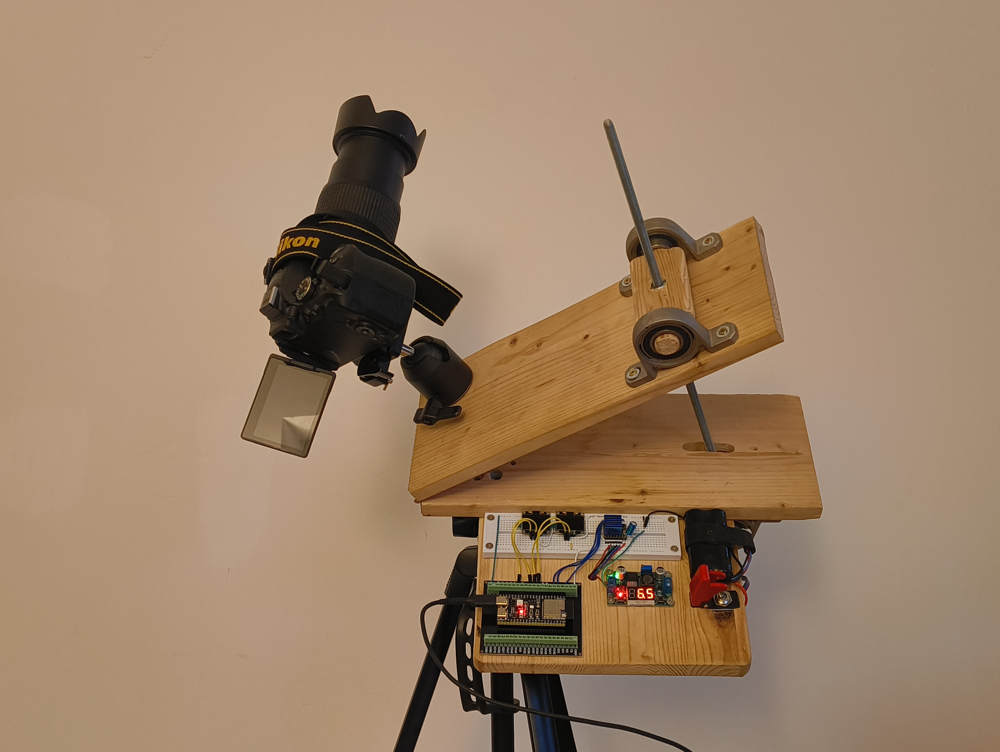
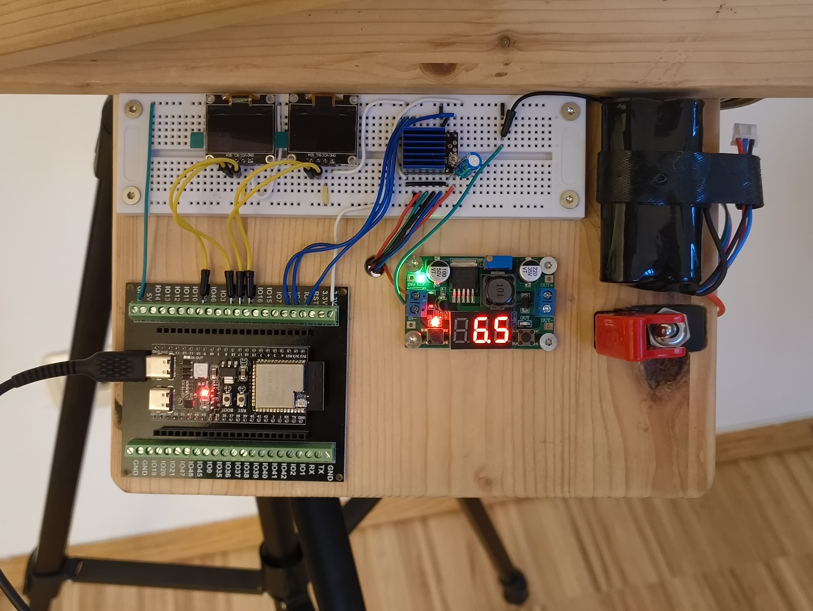
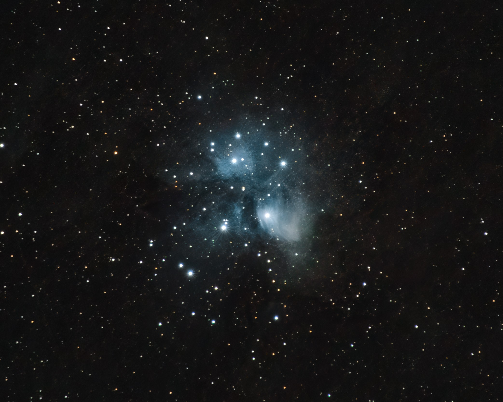

# StarHinge

A DIY isosceles-style [barn door star tracker](https://en.wikipedia.org/wiki/Barn_door_tracker) for astrophotography, built from wood and ball bearings and driven by an ESP32-S3 and a NEMA17 stepper motor. It rotates the camera to cancel out Earth's rotation, so long exposures produce sharp stars instead of trails and capture faint detail in nebulae and distant galaxies ([see results](#results)).

| Tracker | Electronics |
|---|---|
|  |  |

## How it works

Two wooden boards are joined by a hinge aligned with the celestial pole. A stepper motor drives a threaded rod that pushes the boards apart at sidereal rate.

A constant rod speed only approximates the required rotation and builds up a tangent error over time. StarHinge instead calculates the exact rod length for the target hinge angle `θ(t) = ω · t` from the frame geometry and converts it into motor steps, timed by the ESP32's microsecond hardware timer.

| Untracked | Tracked with StarHinge |
|---|---|
|  |  |

## Specs

| Component | Details |
|---|---|
| **Microcontroller** | ESP32-S3-DevKitC-1 |
| **Motor / Driver** | NEMA17, TMC2209 (1/8 microstepping) |
| **Drive** | M8 threaded rod, 1.25 mm pitch |
| **Frame** | Wood |
| **Firmware** | C++, Arduino framework, PlatformIO |
| **Power** | 2S Li-ion battery pack, step-down converter |
| **Bearings** | 20mm pillow block bearings for the threaded rod |

## Results
| Andromeda Galaxy (M31) | Pleiades Star Cluster (M45) |
|---|---|
|  |  |

## Planned Features

- [ ] Wi-Fi access point for speed and direction control via dedicated website
- [ ] Semi-automatic rewind to start position
- [ ] 3D printed parts for better ergonomics
