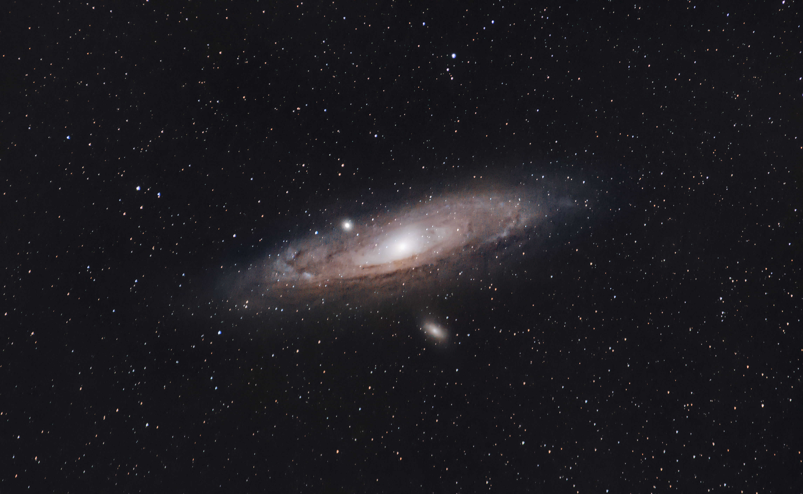
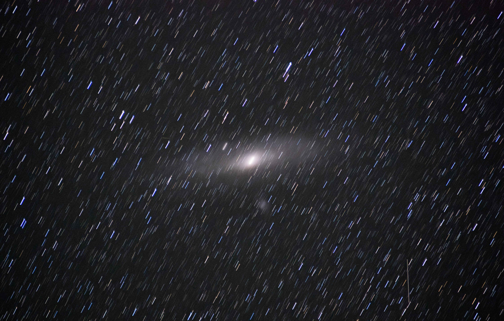
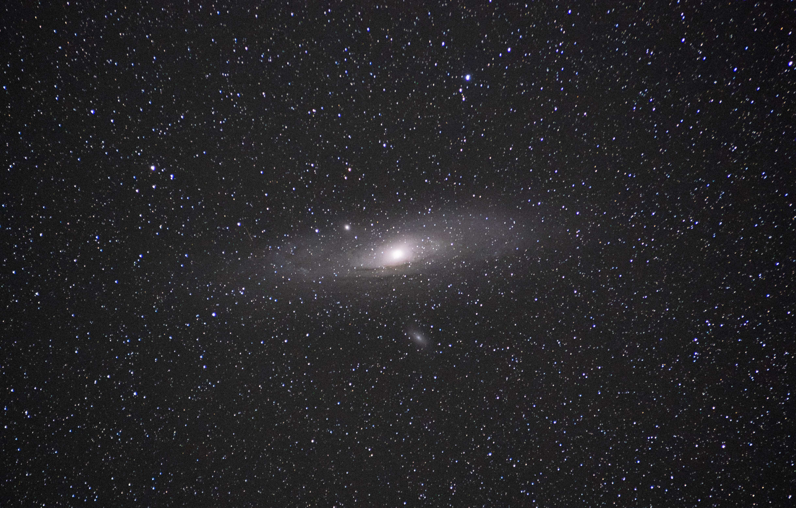

# StarHinge

A DIY barn door star tracker for astrophotography, built from wood and ball bearings, driven by an ESP32-S3 and a NEMA17 stepper motor. It rotates the camera so that it cancels out the earths rotation, leading to long exposures producing sharp stars instead of trails and enabling the capture of much fainter details in nebulae and distant galaxies (see untracked/tracked comparison below).

*Andromeda Galaxy (M31) - preliminary result*

| Untracked | Tracked with StarHinge |
|---|---|
|  |  |

## How it works

Two wooden boards are joined by a hinge aligned with the celestial pole. A stepper motor drives a threaded rod that pushes the boards apart at sidereal rate.

A constant rod speed only approximates the required rotation and builds up a tangent error over time. StarHinge instead calculates the exact rod length for the target hinge angle `θ(t) = ω · t` from the frame geometry and converts it into motor steps, timed by the ESP32's microsecond hardware timer.

## Specs

| | |
|---|---|
| **Microcontroller** | ESP32-S3-DevKitC-1 |
| **Motor / Driver** | NEMA17, TMC2209 (1/8 microstepping) |
| **Drive** | M8 threaded rod, 1.25 mm pitch |
| **Frame** | Wood |
| **Firmware** | C++, Arduino framework, PlatformIO |

## License

[MIT](LICENSE)
